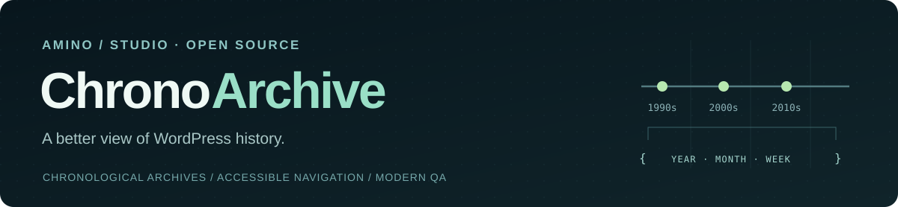

<!-- ChronoArchive · public project landing. No runtime plugin code is published on main until release gates pass. -->
<p align="center">
  
</p>

<p align="center"><strong>Chronological archives for WordPress, redesigned with care for compatibility, accessibility and security.</strong></p>

<p align="center">
  <a href="https://github.com/aminostudio/chronoarchive/pull/10">Development</a> ·
  <a href="https://github.com/aminostudio/chronoarchive/issues">Issues &amp; roadmap</a> ·
  <a href="https://github.com/aminostudio/chronoarchive/actions">Quality checks</a> ·
  <a href="https://aminostudio.fr/">Amino/STUDIO</a>
</p>

---

### What is ChronoArchive?

**ChronoArchive** is an independently maintained GPL fork of **Annual Archive** by Twinpictures. The project modernizes a familiar WordPress feature: navigating published content across time.

The development version supports **yearly, monthly, weekly, daily and decade archives**, alongside alphabetical and post-by-post listings. It provides shortcodes, a classic widget, public custom-post-type support where applicable, and keyboard-friendly select navigation.

### Development preview

```text
[chronoarchive type="yearly" show_post_count="1"]
[chronoarchive type="decade" order="ASC"]
[chronoarchive type="weekly" limit="10"]
[chronoarchive type="monthly" format="option" select_text="Choose a month"]
```

Legacy `[archives]` and `[arcpromat]` aliases are retained in the development code.

> **⚠️ Not ready for production.** ChronoArchive is in **2.1.0-beta1 development**. The `main` branch currently contains this project landing page, **not an installable plugin release**. WordPress.org review, release packaging, SQL improvements and the final inherited-vulnerability audit are outstanding. Do not install source snapshots on production websites.

### How we're building it

| Area | Approach |
| --- | --- |
| Security | Preserve upstream attribution; review XSS advisories, WordPress permissions and input/output boundaries |
| Compatibility | Test older WordPress/PHP combinations, custom post types and legacy shortcodes |
| Accessibility | Labeled dropdowns, keyboard behavior, semantic output |
| Quality | Automated PHP and JavaScript tests, real WordPress and multisite CI, HTTP archive checks |
| Transparency | Open issues, documented blockers and reviewable pull requests |

**Source under review:** [integrated security branch and PR #10](https://github.com/aminostudio/chronoarchive/pull/10). This is an audit trail, not a completed security guarantee.

**Current release gates:** [Security audit #2](https://github.com/aminostudio/chronoarchive/issues/2) · [WordPress.org metadata #3](https://github.com/aminostudio/chronoarchive/issues/3) · [SQL and integration #4](https://github.com/aminostudio/chronoarchive/issues/4).

We intentionally separate **passing tests** from **approval to release**. A green development job never overrides unresolved Plugin Check findings.

### Provenance and license

ChronoArchive is a **GPL-2.0-or-later** project based on **Annual Archive**, originally by **Twinpictures** and contributors. Inherited credits and third-party license notices are preserved in the [development source](https://github.com/aminostudio/chronoarchive/tree/develop/import-lab-beta1). This is an independent fork, not an official continuation endorsed by the original authors.

Maintained by **[Amino/STUDIO](https://aminostudio.fr/)**. For vulnerabilities, use a **private security report**, not a public exploit issue.

<sub>Built for clear code, responsible releases, and useful WordPress archives.</sub>
